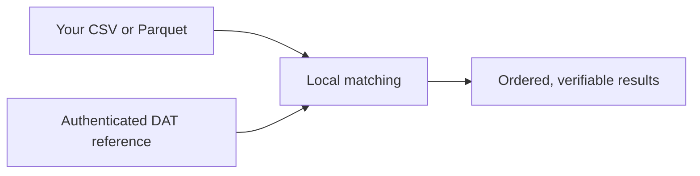

# MatchPoint

### Find the match. Keep the data local.

Stream CSV and Parquet files against a compact reference collection, run the comparison on your machine, and pick up interrupted jobs where they left off. Built in Rust, with an interactive terminal workspace and a scriptable CLI.

[](https://github.com/osvaldoandrade/matchpoint/actions/workflows/ci.yml)
[](LICENSE)
[](rust-toolchain.toml)

**[Read the docs](https://github.com/osvaldoandrade/matchpoint/wiki/EN-Home)** · **[Get started](https://github.com/osvaldoandrade/matchpoint/wiki/EN-Getting-started)** · **[Explore the CLI](https://github.com/osvaldoandrade/matchpoint/wiki/EN-CLI-reference)**

Documentation: [English](https://github.com/osvaldoandrade/matchpoint/wiki/EN-Home) · [Português](https://github.com/osvaldoandrade/matchpoint/wiki/PT-BR-Home) · [Español](https://github.com/osvaldoandrade/matchpoint/wiki/ES-Inicio)

## From reference to results



- **Work locally.** Match identifiers against a downloaded reference, with no HTTP request per input record.
- **Stream the input.** Read CSV or Parquet in bounded batches and share one immutable reference across workers.
- **Keep your place.** Pause and resume jobs with checkpoints that pin the input, rules and reference.
- **Check the result.** Preserve input order and duplicates, verify output integrity, and refuse to overwrite an existing result.
- **Choose your workflow.** Use the terminal interface for interactive jobs or the CLI for repeatable commands.

Reference data uses Bloom filters. A `true` result means **possible presence**; `false` means absence when the producer and consumer use the same rules. Read [results and integrity](https://github.com/osvaldoandrade/matchpoint/wiki/EN-Results-and-integrity) before interpreting a match.

## Install with one command

**macOS and Linux** — run as your normal user:

```sh
curl --proto '=https' --tlsv1.2 -fsSL https://raw.githubusercontent.com/osvaldoandrade/matchpoint-install/main/install.sh | bash
```

The installer prepares build tools, installs the pinned Rust toolchain when needed, clones the source and runs `cargo build --locked --release`. It installs `matchpoint` and the compatible `pgm-data` command for your user.

<details>
<summary><strong>Windows: install through PowerShell and WSL2</strong></summary>

```powershell
curl.exe --proto '=https' --tlsv1.2 -fSL https://raw.githubusercontent.com/osvaldoandrade/matchpoint-install/main/install.ps1 -o install-matchpoint.ps1
if ($LASTEXITCODE -eq 0) { powershell -NoProfile -ExecutionPolicy Bypass -File .\install-matchpoint.ps1 }
```

Windows runs MatchPoint inside Ubuntu on WSL2. On first use, finish any Windows restart and create your Linux user, then rerun the installer. Open Ubuntu to use MatchPoint.

</details>

On macOS, first-time setup may open the Apple Command Line Tools installer. Complete that step and rerun the command. See [installation](https://github.com/osvaldoandrade/matchpoint/wiki/EN-Installation) for custom paths, updates and recovery.

## Open your workspace

Start a new terminal, or open Ubuntu on Windows:

```sh
matchpoint tui
```

Configure your reference API and sign in, select a dataset and its matching key, then start a job. Follow [your first comparison](https://github.com/osvaldoandrade/matchpoint/wiki/EN-Getting-started) for the integration details.

Prefer the command line? Start with `matchpoint --help` or `matchpoint manual`.

## Go deeper

| Your next step | Guide |
| --- | --- |
| Learn the keyboard workflow | [Terminal interface](https://github.com/osvaldoandrade/matchpoint/wiki/EN-Terminal-interface) |
| Prepare inputs and matching rules | [Datasets and rules](https://github.com/osvaldoandrade/matchpoint/wiki/EN-Datasets-and-rules) |
| Understand credentials and locked memory | [Authentication](https://github.com/osvaldoandrade/matchpoint/wiki/EN-Authentication-and-secrets) · [Memory](https://github.com/osvaldoandrade/matchpoint/wiki/EN-Memory-and-parallelism) |
| Recover an interrupted job | [Jobs and recovery](https://github.com/osvaldoandrade/matchpoint/wiki/EN-Jobs-and-recovery) |
| Build, test or contribute | [Development](https://github.com/osvaldoandrade/matchpoint/wiki/EN-Development-and-testing) · [Architecture](https://github.com/osvaldoandrade/matchpoint/wiki/EN-Architecture) |

## License

MatchPoint's project code is available under the [MIT License](LICENSE). Third-party components retain their own licenses. The bundled VGA font by VileR remains under **CC BY-SA 4.0**; see its [attribution](assets/fonts/ATTRIBUTION.md) and [license](assets/fonts/LICENSE.txt).
