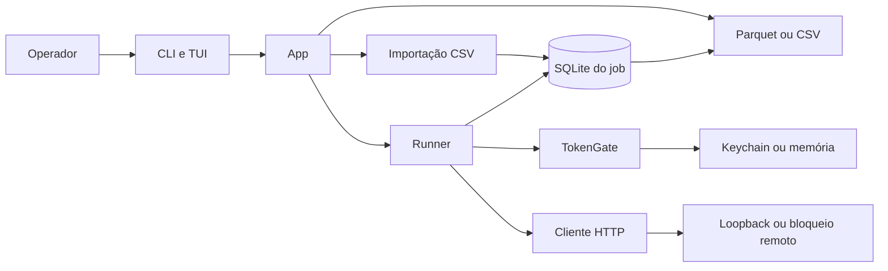

# Arquitetura



Escopo: um processo, em 2026-10-13. Fonte: este repositório.

```mermaid
sequenceDiagram
  participant W as Worker
  participant DB as Thread SQLite
  participant API as HTTP
  W->>DB: claim e commit IN_FLIGHT
  DB-->>W: row_id e cpf
  W->>API: POST cpf
  API-->>W: status ou erro
  W->>DB: outcome na fila limitada
  Note over DB: commit em grupo; antes disso a linha segue IN_FLIGHT
```
